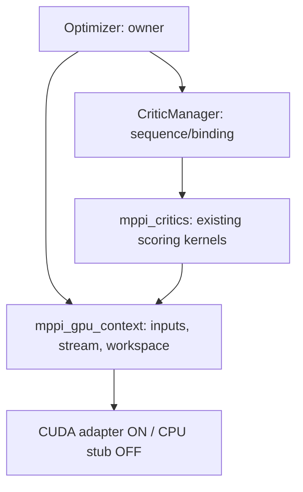

# R2 — общий GPU-контекст MPPI

**Дата:** 2026-10-24. **Статус:** архитектурное предложение; R2 не реализован.
**Source baseline:** 9557655b + незакоммиченные baseline/TASK-002 fixes; проверенные факты среды и результатов — [environment](performance-profiler-environment.md), [baseline](../tasks/TASK-001/performance-profiler-report.md), [correctness fixes](../tasks/TASK-002/systematic-debugger-report.md).
**Target:** desktop RTX 3060. Jetson — отдельный будущий этап.
**Task:** [TASK-003](../tasks/TASK-003/STATE.md).

## 1. Контекст, цель и границы

[VERIFIED source] Optimizer::optimize вызывает CPU generateNoisedTrajectories → CriticManager::evalTrajectoriesScores → updateControlSequence на каждой iteration. Сейчас CostCriticCuda и ObstaclesCriticCuda независимо владеют stream/buffers, копируют map/x/y и ждут stream перед чтением host result. Источники: `nav2_mppi_controller/src/optimizer.cpp`, `src/critic_manager.cpp`, `src/critics/{cost_critic,obstacles_critic}_cuda.cu`.

R2 создаёт один контекст на optimizer для device map, x/y и переиспользуемого workspace critics. Не переносит log/exp/reductions, footprint, noise/rollout или финальный control update: их численный контракт и kernels относятся к R3–R5. Пути, yaw, state/control arrays и device costs подключаются по мере появления GPU consumers/producers; заранее копировать неиспользуемые данные не нужно. Это уточняет широкий R2 в первоначальном roadmap.

Context здесь — программный owner streams/buffers, не требование создавать отдельный CUDA Driver context на каждый optimizer. Не вводить собственное управление/reset primary device context.

Цель R2: убрать независимое управление одними входами, исключить повторную загрузку тех же x/y между совместимыми critics одной iteration, сохранить карту между iterations одного control call и подготовить GPU producers R4. После выхода из controller call устройство не считается авторитетным источником карты или новых CPU trajectories.

[VERIFIED source + inference] При одном CUDA critic x/y всё ещё создаются CPU и загружаются на каждой iteration: общий контекст сам по себе не устранит крупнейший H2D в baseline. Существенное сокращение этих transfers ожидается только с device rollout R4. Совместное использование двумя critics проверяет архитектуру, но не является рекомендацией включить их оба в продукт: это меняет веса obstacle objectives.

## 2. Требования и критерии

| ID | Требование | Критерий R2 |
|---|---|---|
| R2-01 | Один owner, несколько потребителей | Два CUDA critics используют один map/x/y allocation set одного optimizer; два optimizer не делят mutable resources |
| R2-02 | Явная свежесть данных | Каждая новая CPU trajectory generation инвалидирует batch; каждая control cycle инвалидирует карту независимо от pointer/dimensions |
| R2-03 | CPU-плагины совместимы | CriticFunction::score и CriticData не меняются; opaque plugins выполняются в прежнем порядке и создают консервативный barrier |
| R2-04 | Численная семантика сохранена | Отдельные float/double worldToMap, stride, footprint, near-goal, costs/fail/collision flags проходят прежний контракт |
| R2-05 | Без double counting при отказе | Host outputs коммитятся только после successful completed GPU operation; fallback пересчитывает только текущий critic |
| R2-06 | Полный lifecycle | configure/partial failure/reset/retry/reconfigure/shutdown/destructor не оставляют активных views или callback после owner destruction |
| R2-07 | CPU-only и opt-in сохранены | NAV2_MPPI_CUDA=OFF без toolkit; use_cuda=false по умолчанию и независим для каждого critic |
| R2-08 | Измеримый результат | Per-instance upload/byte/launch/allocation/sync/fallback counters и полный controller wall-time/CPU comparison |
| R2-09 | Ресурсы ограничены входами и caps | Проверки размеров/умножений/byte capacity до allocation/launch; отсутствие allocation при неизменном warmed shape |
| R2-10 | История и артефакты воспроизводимы | Source revision/diff hashes, OFF/ON flags, image/overlay identity и raw samples фиксируются после реализации |

## 3. Компоненты и зависимости

Выбран небольшой shared target `mppi_gpu_context` внутри существующего `nav2_mppi_controller`. Это общая CUDA-resource boundary, не новый ROS node/package/process или общий фреймворк ускорителей.

[VERIFIED source] `mppi_critics` уже связан с `mppi_controller`; контекст внутри critics, вызываемый из optimizer, создал бы обратную зависимость. Выделенный target устраняет эту зависимость и сохраняет CUDA headers вне core/plugin contracts. Источники: `nav2_mppi_controller/CMakeLists.txt`, exports/install targets.

Предлагаемые точные места (новые файлы ещё НЕ созданы):

| Файлы | Ответственность |
|---|---|
| NEW `include/nav2_mppi_controller/tools/gpu_context.hpp` | Pure C++17-compatible facade/Pimpl: lifecycle, generations, limits, status, per-instance stats; CUDA/Eigen/ROS headers не нужны |
| NEW `include/nav2_mppi_controller/critic_gpu_interface.hpp` | Вторичный opt-in interface потребителя: attach/detach, требуемые inputs, режим CPU/CUDA; base CriticFunction не меняется |
| NEW `src/gpu_context.cpp` | Host validation, epochs/state machine, диагностические counters и общая facade logic |
| NEW `src/gpu_context_backend.hpp` | Package-private C++17 bridge к opaque backend: reserve/copy/drain/status, без CUDA types в CXX compilation |
| NEW `src/gpu_context_cuda.cu` / `src/gpu_context_stub.cpp` | Взаимоисключающие ON/OFF adapters для stream/events/device memory; OFF не включает CUDA headers |
| NEW `src/gpu_context_device.hpp` | Package-private native device lease/view для `.cu` consumers; не устанавливать как публичный plugin header |
| MODIFY `include/nav2_mppi_controller/optimizer.hpp`, `src/optimizer.cpp` | Owner и begin/end control/batch, reset/shutdown lifecycle |
| MODIFY `include/nav2_mppi_controller/critic_manager.hpp`, `src/critic_manager.cpp` | Обнаружение вторичного interface при загрузке, binding, opaque CPU barriers |
| MODIFY critic headers, cpp, cuda helpers/stubs | Два встроенных CUDA consumers, общий input lease и private standalone context |
| MODIFY package/test/benchmark CMake, parity/manager/optimizer tests, baseline harness | Общий target, OFF/ON coverage, counters и failure/lifetime fixtures |

CMake: создать/экспортировать/install `mppi_gpu_context`, выбирать ровно один backend. CUDA language/toolkit/host-flag scoping разместить до CUDA-enabled targets. `CUDA::cudart` — private dependency ON adapter, никаких обязательных toolkit headers в OFF builds. `mppi_controller` экспортирует связь с context target, если inline Optimizer destructor в installed header требует его symbols; `mppi_critics` связывается с тем же target. Не дублировать backend в двух DSOs. Проверить relocation и downstream link как часть acceptance.

## 4. Plugin seam и совместимость

Выбран opt-in secondary interface, реализуемый CostCritic/ObstaclesCritic. CriticManager обнаруживает его один раз после loadCritics и хранит observer на время жизни соответствующего critic. RTTI уже используется в репозитории (dynamic_cast в MPPI tests); точные visibility/key-function/export правила нового interface фиксируются следующим контрактом. Это не добавление virtual method в CriticFunction и не новый field в CriticData.

Legacy CPU plugins получают прежние score(CriticData&) и layout. Они не обязаны знать GPU context. Дополнительный RTTI/interface реализуют только проверенные GPU consumers; контекст не передаёт resource ownership плагинам.

Контракт v1 также вводит ReadOnlyInputsV1 marker для source-audited встроенных CPU critics; старый unmarked plugin остаётся opaque. Это сохраняет reuse без небезопасного доверия имени plugin.

Режимы отличать явно:

- Standalone critic без manager/owner: private instance context того же resource engine; прежние parity tests и прямой вызов score поддерживаются.
- Attached: заимствует optimizer-owned context в пределах score; не освобождает его.
- Detached/closed managed consumer: не должен создавать private CUDA context после shutdown; до нового attach доступен только разрешённый CPU path/ошибка lifecycle.

Не полагаться на process-global counters/timings для работы нового engine. Авторитетная статистика — per context. Существующие глобальные helper diagnostic functions требуют явной migration/deprecation policy в interface design; нельзя сохранить неатомарные global writes в concurrent managed path или молча поменять их threading semantics. Legacy helpers/test-facing API совместимость проверяется отдельно от ROS plugin ABI.

Сигнатуры score, plugin ids и use_cuda defaults сохраняются. Layout встроенных derived critics и core может измениться: обязательна полная пересборка/переустановка native consumers. Возможность загрузить ранее собранный CPU plugin должна проверяться отдельным downstream fixture, не выводиться только из неизменности score. Никаких wire/file/persistent format изменений.

## 5. Владение и время жизни

Optimizer единолично владеет `unique_ptr<mppi::gpu::Context>`. Context владеет backend, stream, events, device buffers и собственными host input-staging/output workspaces. CriticManager и critics — observers; lease не продлевает owner lifetime и не может уходить в background thread.

Owner field объявляется до зависимых manager/critic objects, чтобы при обратном порядке уничтожения context жил дольше потребителей. Полное определение facade без CUDA types доступно inline destructor Optimizer; Pimpl destructor определён out-of-line. Другой допустимый вариант — вынести Optimizer destructor out-of-line; окончательно выбрать в интерфейсном контракте.

Каждый consumer завершает использование lease до выхода из score, после host result consumption. Following critic может переиспользовать workspace только после этого. На reset/reconfigure старые leases инвалидируются generation token; detached pointers не превращаются в dangling observers. Никаких кэшей device addresses у стороннего кода между score calls.

## 6. Свежесть карты и траекторий

CPU остаётся authoritative producer в R2. Tokens выдаёт owner, а не consumer и не сравнение указателей:

1. `beginControl` после prepare, под уже существующим parameter/costmap lock, создаёт новый control epoch. Map bytes + dimensions + double origin/resolution принадлежат этому epoch. Host bytes копируются в owner staging под lock до enqueue; driver не получает долгоживущий borrow caller memory.
2. Upload карты — lazy при первом активном CUDA consumer. Один upload на epoch, если все intervening consumers известны как read-only по карте.
3. Сразу ПОСЛЕ каждого generateNoisedTrajectories owner вызывает beginBatch с новым batch sequence. Первый CUDA consumer копирует x/y в owner staging и загружает их; следующие в том же batch используют device inputs без копий.
4. CPU updateControlSequence и следующая trajectory generation завершают предыдущий batch. Никакого reuse по совпадению адреса/размеров Eigen arrays.
5. EndControl завершает outstanding work до release costmap lock; перенос map validity в следующий call запрещён в первой реализации.

[VERIFIED source] Controller держит parameter/costmap locks вокруг evalControl (`src/controller.cpp`). Это позволяет получить согласованный host snapshot под lock. Это не гарантия, что произвольный plugin не изменит карту внутри того же потока.

Opaque CPU plugin — явный barrier: выполнить в прежнем порядке, перед/после него drain/invalidate affected device inputs; консервативно инвалидировать map и batch даже если plugin фактически ничего не изменил. Следующий GPU consumer получает свежие inputs. Для проверенных встроенных read-only critics можно сохранить epoch. Оптимизацию barrier разрешать только после явного read/write contract; класс plugin по имени или const pointer не является доказательством.

Retry/reset получает новые generations даже при iteration index=0 и неизменных pointers. Counter overflow приводит к безопасной инвалидизации/новому context вне активных leases, не к совпадению старых tokens. Moving origin/resolution/resize/clear между control calls всегда видны следующему upload. Dirty ROI, карта между процессами и content-hash caching — будущие оптимизации, не R2.

## 7. Численная семантика

[VERIFIED source] CostCritic::worldToMapFloat и params origin/resolution — float; ObstaclesCritic использует double Costmap2D metadata. CostCritic имеет trajectory_point_step (default 2); ObstaclesCritic читает все time columns. Источники: critic headers/cpp и cuda kernels.

Разделяются общие BYTES map/x/y, а не готовые результаты lookup. Общая metadata хранит исходные doubles; CostCritic получает те же float casts, что до R2, в том же месте вычислений. Existing separate kernels/ordering сохраняются; результаты float/strided CostCritic нельзя использовать как cache для double/full-width ObstaclesCritic.

Footprint checks, log, min, weight/power остаются на host как сейчас. Общий workspace имеет явный result kind/shape/precision tag, а не неразличимый float pointer. Preserve incoming costs, fail assignment semantics, collision flags previously set by other critics. Действующий bitwise contract не ослабляется; R2 не повод вводить tolerance для scoring. NaN/Inf/integer boundary behavior фиксировать на adapter input boundary без изменения существующей CPU algorithm policy.

## 8. Потоки и синхронизация

Score выполняется на controller thread; configure/reset/shutdown могут вызываться lifecycle thread. Для одного owner операции должны быть сериализованы, но нельзя предполагать один и тот же OS thread. Нужны explicit device identity и корректная backend entry на каждом вызывающем thread; multi-GPU migration не входит в R2. Отдельного worker/thread pool/ISR нет. Existing ControllerServer сначала деактивирует action server, затем очищает controllers (`nav2_controller/src/controller_server.cpp`); завершение callbacks до drain/unbind требуется подтвердить интеграционным lifecycle test. CUDA work идёт в его explicit stream. Context не thread-safe для одновременных score одного owner; contract должен запретить/обнаружить такое использование. Два optimizer имеют независимые buffers, streams, generations и counters. Это не аппаратная fault isolation: fatal device/runtime failure может затронуть несколько owners на одной GPU; каждый прекращает выдавать invalid results, никаких общих автоматических reset.

Результат для host scoring выдаётся только после успешного completion соответствующего stream/event. R2 не обещает убрать последний sync перед CPU consumption. Запрещены device-wide sync и неявная зависимость от default stream; никаких callbacks, которые после shutdown пишут в caller-owned memory.

Caller map/x/y заимствуются только на время синхронного копирования в owner staging. DMA читает owner memory; producer не зависит от незавершённого H2D после error return. Staging нельзя менять/grow/free до доказанного завершения относящихся к нему operations. Дополнительные CPU copies входят в measurement и могут уменьшить выигрыш R2; устранять их можно только при доказанном альтернативном lifetime contract. Native stream/pointers доступны только package-private CUDA adapter/consumers, не CPU plugin interface. Kernel launch и D2H всегда используют ту же owner/generation lease.

## 9. Lifecycle, ошибки и восстановление

State machine: **idle → control-active → batch-ready → critic-in-flight → result-ready → batch-ready → idle**. Ошибка ведёт в **CPU-for-cycle** (после доказанной quiescence) либо **faulted**. Закрытие: **draining → closed**. Точные status codes и exception mapping — следующий interface contract.

- Configure: построить lightweight owner и bindings; не инициализировать CUDA при отсутствии requested GPU consumers. Device setup/reserve lazy или prewarm вне timed steady loop.
- Partial failure: unbind consumers, drain завершённые зависимости и освободить owned resources; ошибка не оставляет attach к уничтоженному owner.
- Reset/retry: drain перед reuse, invalidate batch/map, сохранить allocations допустимой capacity. Lifecycle statistics отличают retry от нового control call.
- Reconfigure: stop noise producer/consumers, unbind, drain, только затем заменить/закрыть context и bind новой configuration. Validator/model/plugin loader должен жить дольше предыдущих instances. Непроверенная validator reinitialization из TASK-002 DEFERRED — prerequisite lifecycle regression R2, не молчаливое предположение.
- Shutdown/destructor: idempotent; запретить новые leases, завершить outstanding operations, отвязать observers, освободить buffers/events/stream. Destructor не бросает; ошибки завершения сохраняются в bounded diagnostic status.

При отсутствии CUDA/валидных, но неподдержанных размеров/capacity/reserve failure — CPU для текущего critic/cycle. Invalid descriptor (shape/length/overflow/null) не передавать CPU scorer как будто он безопасен: controlled input error до kernel/host scoring. При GPU operation failure не модифицировать host costs/flags до получения valid completed result. После успешного drain пересчитать только текущий critic на CPU; предыдущие contributions не обнулять и не применять повторно. После первого отказа не повторять device setup у каждого следующего critic этого cycle.

Если нельзя подтвердить, что GPU больше не пишет host staging buffer, нельзя освобождать/повторно использовать его или продолжать с partial results. Context удерживает ownership failed buffers и переходит в faulted; controller получает существующую ошибку управления вместо команды из невалидных данных. CUDA-specific quiescence/error guarantees и recoverability надо проверить по vendor contract при interface design. Не выполнять cudaDeviceReset, reset GPU или менять настройки устройства автоматически. Recovery policy отдельно отличает transient OOM от device/context failure; не добавлять sleeps/retries без измеренной причины.

## 10. Ресурсы и бюджеты

R2 preallocates/reuses map, x, y, float result scratch, collision flags/reduction scalar и host result workspace; отдельный буфер для каждого critic не нужен при serial lease. Никаких unbounded queues. Не требовать pinned/unified/zero-copy memory: сначала сохранить действующую передачу, измерить изменения, затем отдельная оптимизация.

Для P=N*T оценка основных device payload buffers при reuse scratch: `map_bytes + 3*P*sizeof(float) + N*sizeof(uint8_t) + sizeof(uint32_t)`, без CUDA runtime/events overhead. Для baseline N=2000,T=56,map=40*40 это 1 347 604 bytes; это расчёт, не measured peak. Host owned input/output workspace ≈map_bytes+3*P*sizeof(float)+flags, CPU-owned original trajectories не включены. Точный reserve plan зависит от окончательного helper contract.

До allocation/launch проверить non-null buffer views (pointer+length; не std::span в общем C++17 header), x/y shape agreement, costs/collision dimensions, positive finite resolution, dimensions/ranges, checked size_t products/sums, narrowing в existing int kernel counts/grid и budget/capacity. Не исправлять overflow с помощью silent clipping. Любой output invalid до successful operation completion.

После warmup с неизменным shape: ноль context device allocations/growth; размеры capacity не меняются внутри critic loop без учёта growth. Resize может потребовать allocation и sync: это отдельно измеряемый cold/growth path, не bounded steady-state latency. Конфигурационные caps/peak byte limit и политика превышения (CPU fallback) должны быть конкретизированы до implementation. Продуктовые VRAM/deadline/jitter budgets пока [UNKNOWN]; архитектура не выдаёт их за выполненные. Не менять clocks/governor/другие GPU workloads ради принятия результата без отдельного scope.

## 11. Наблюдаемость

Per-context: owner/generation id, map/x-y upload counts/bytes, output D2H counts/bytes, allocations/growth/capacity high water, launches, sync time, fallback reason/count и failure status. Aggregate в конфигурационных boundaries, без per-sample logging. Diagnostics не влияют на алгоритм и не используют незащищённые globals. Optional detailed timings измерять отдельно от release baseline из-за overhead.

Для двух GPU consumers без opaque barriers: map upload=1 per healthy control epoch, x/y upload=1 per generated batch. При standalone/opaque plugin/growth/retry тест ожидает другое число явно. Не выдать снижение counters за снижение computeVelocityCommands latency. Сравнение CPU, прежнего CUDA path и R2 — одинаковые raw inputs/shapes, 1000 calls × 5 повторов, p50/p95/p99/max, process CPU, bytes и peak resource observations; фоновые условия фиксируются как в TASK-001.

## 12. Альтернативы и выбор

| Вариант | Решение |
|---|---|
| Независимые contexts на critic | Сохранить только standalone behavior; не даёт shared input residency |
| Process-global singleton/device map | Отклонён: ownership, stale snapshots, concurrent controllers и recovery связаны неявно |
| Добавить pointer в CriticData | Отклонён в пользу secondary interface: затрагивает aggregate/layout каждого CPU plugin и многочисленные initializers |
| Новая virtual function в CriticFunction | Отклонена: изменяет общий plugin vtable |
| Context/CUDA код внутри mppi_critics | Отклонён как owner boundary: обратная зависимость из optimizer |
| Встроить CUDA backend в mppi_controller | Возможен, но смешивает core target flags/toolkit coupling; выбран малый shared resource target с чистой OFF boundary |
| Persistent map между control calls без version source | Отклонён: одинаковый pointer/shape не означает неизменную карту |
| Полный GPU optimizer сразу | Отложен: объединяет R2 с численными изменениями R3–R5 и затрудняет attribution/regression |

## 13. Verification и переход к implementation

До кода нужен interface-design artifact: exact host/device descriptors, secondary plugin seam, ownership/lease tokens, status/recovery codes, dimensions/caps, diagnostic API migration, visibility/export и source/binary compatibility. Затем отдельный implementation plan с commit boundaries. Это не утверждение реализации или гарантия speedup.

Acceptance tests будущей реализации:

- CPU OFF build без CUDA headers/runtime; ON build на RTX 3060, use_cuda=false не выполняет explicit CUDA operations.
- Два CUDA consumers и обе последовательности, один GPU/один CPU, flags OFF/disabled, standalone и managed paths; уже накопленные costs/flags сохраняются.
- Same address/shape с изменившимися map bytes; resize, moving origin, resolution, retry iteration=0, reset/reconfigure и two owners. Test counts доказывают upload reuse и требуемую invalidation.
- Float/double near-cell boundaries, CostCritic stride vs every column, footprint, unknown/off-map, power, near-goal, empty collision tracking и preseeded flags: прежняя numerical parity + command replay.
- Opaque CPU critic, изменяющий карту/inputs в допустимом test seam: новый epoch/barrier; нельзя получить stale result.
- Fault injection до/после enqueue/copy/launch/D2H: no partial host commit, safe fallback либо controlled fault, no callback/write after owner release.
- Attach/detach/partial configure, no-device, OOM, capacity growth, repeated shutdown и validator reconfigure regression; ASan/UBSan/LSan host paths, device memcheck/racecheck при доступных инструментах.
- Полные package configure/build/CTest OFF/ON с фактическим cppcheck; downstream CPU plugin compile/load/link, exported context runtime relocation. Исторические commands в TASK-002 — baseline, не уже выполненная R2 verification.

Exact limits/defaults, statuses, secondary markers, weak identity tokens и diagnostic migration определены в interface-designer-contracts.md как proposed v1 policy. Lifecycle reconfigure/fault guarantees ещё требуют implementation tests и review; исходный production API этим документом не изменён. Budget acceptance и весь Nav2 profile остаются отдельными milestones roadmap.

## 14. Проверка этой архитектуры — DOD Tier 0

Scope/platform/unknowns явно указаны; R2-01…10 сопоставлены компонентам и acceptance. Source facts проверены чтением указанных файлов; архитектурные решения помечены proposed. Новых code/config/API changes в этом шаге нет; только docs/policy correction и design.

Commands: `git diff --check`; local Python validation Markdown links/sections, expected source anchors and unchanged TASK-002 source hashes; `rg` check current project descriptions for obsolete hardware model. Build/test/sanitizer/target checks R2 — **NOT RUN: implementation ещё нет**. Не переиспользовать PASS TASK-002 как evidence нового context.
