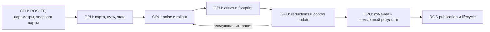

# Глобальный roadmap NVIDIA GPU для Navigation2

**Дата:** 2026-10-23. **Baseline:** `9557655b38a839b7c14e0aff862f63332f7ec7e4`.
**Статус:** план разработки; перенос следующих компонентов ещё не реализован.
**Уточнение 2026-10-24:** desktop RTX 3060; архитектура R2 — [architect-architecture.md](architect-architecture.md).
**Target:** desktop RTX 3060 — решение пользователя. Jetson — будущий отдельный этап.
**Общая ветка:** `feat/gpu-adaptation`; каждая реализация — отдельная ветка от неё, интеграция после проверок согласно [AGENTS.md](../AGENTS.md).
**План исполнения:** [TASK-001](../tasks/TASK-001/writing-plans-plan.md).

## Цель и границы

[VERIFIED — human decision] Максимально перенести вычисления проекта на NVIDIA GPU. Текущий этап ориентирован на desktop; перенос на Jetson не блокирует desktop-релиз.

[PROPOSED] Практический результат: GPU выполняет основной массив численных вычислений активной навигационной конфигурации; CPU обслуживает ROS, TF, lifecycle, orchestration и совместимость. Кандидат на перенос оценивается целиком с передачами данных и синхронизацией. GPU utilization и количество kernels сами по себе не являются результатом.

[UNKNOWN] Ещё не определены конфигурация робота/сенсоров, набор активных плагинов, рабочая частота, допустимые отклонения, VRAM budget и минимальный speedup. Их фиксация — R0; roadmap не подменяет эти значения произвольными обещаниями. Перенос каждого используемого тяжёлого вычислительного блока либо завершается GPU-реализацией, либо получает измеренное обоснование исключения. Неиспользуемые плагины не считаются ускорением продукта.

[VERIFIED] Host и исторические тесты описаны в [repository context](repository-doc-context.md). Desktop GPU и baseline — RTX 3060, модель подтверждена пользователем 2026-10-24; performance acceptance требует контролируемого workload. Основной C++20, CUDA units C++17, ament/colcon/CMake; source evidence — build files, перечисленные в context. Отдельный project profile пока отсутствует.

## Откуда начинаем

[VERIFIED] В общей ветке уже находятся optional CUDA CostCritic и ObstaclesCritic, CPU fallback, parity tests, resize tests и timing benchmarks. Основной optimizer, остальные critics и прочие пакеты остаются CPU. Подробные границы реализации/исторические результаты — в context; новый roadmap не объявляет их заново проверенными.

Проверенные точки приложения усилий:

| Область | Источник / символ | Что изучать или переносить |
|---|---|---|
| MPPI pipeline | `nav2_mppi_controller/src/optimizer.cpp`: optimize, generateNoisedTrajectories, updateControlSequence | Batch trajectories, reductions, exp/normalization, control update |
| Noise | `nav2_mppi_controller/src/noise_generator.cpp`: generateNoisedControls, noiseThread | Создание/повторное использование шумов и синхронизация |
| Dynamics | `nav2_mppi_controller/include/nav2_mppi_controller/motion_models.hpp`: MotionModel::predict, applyConstraints | DiffDrive, Omni, Ackermann, acceleration/latency semantics |
| Scoring | `nav2_mppi_controller/src/critic_manager.cpp`; `src/critics/*.cpp` | Все активные critics, порядок и collision flags |
| Footprint | `nav2_costmap_2d/src/footprint_collision_checker.cpp` | Batched polygon checks; точное воспроизведение текущей растеризации |
| Costmap inflation | `nav2_costmap_2d/plugins/inflation_layer.cpp`: updateCosts, applyInflation; `include/nav2_costmap_2d/distance_transform.hpp`: distanceTransform2D | Distance transform, LUT application, ROI |
| Sensor grids | `nav2_costmap_2d/plugins/obstacle_layer.cpp`, `voxel_layer.cpp`; `nav2_voxel_grid/include/nav2_voxel_grid/voxel_grid.hpp` | Marking, clearing/raytracing, projection |
| Localization | `nav2_amcl/src/sensors/laser/likelihood_field_model.cpp`: sensorFunction; `src/pf/pf.c`: pf_update_sensor, pf_update_resample | Particle × beam scoring; затем normalization/resampling |
| Planning | `nav2_smac_planner/include/nav2_smac_planner/a_star_impl.hpp`: createPath; `src/obstacle_heuristic.cpp`, `costmap_downsampler.cpp`, `collision_checker.cpp`, `smoother.cpp` | Сначала batch preprocessing/heuristics/collision; затем исследование search |
| Collision monitor | `nav2_collision_monitor/src/{pointcloud,scan,polygon,circle}.cpp` | Возможное batch geometry acceleration при сохранении deadline/fallback |

[VERIFIED] Это source-level наличие вычислений, а не профиль горячих точек. Приоритеты ниже — [PROPOSED], после R1 порядок вне основного MPPI пути пересматривается по измерениям.

## Архитектурное направление

[PROPOSED] Целевой MPPI dataflow:

Это направление для последующего архитектурного решения, не готовый API. Обычный цикл должен избегать полного возврата batch trajectories и повторной загрузки одинаковой карты между critics. Для visualization/debug разрешён отдельный явно измеряемый путь выгрузки.

Границы, которые требуется спроектировать до R2:

- Один context на controller/optimizer instance, явный owner, bounded capacity, отсутствие process-global mutable state в рабочем API.
- Версионированный costmap snapshot: размеры, origin, resolution, footprint, unknown policy и sequence/version относятся к одной версии; нельзя читать host-карту конкурентно с изменением.
- Собственный stream/event graph и явные точки ожидания; CPU fallback не читает незавершённый D2H и не смешивает частичный GPU-result с CPU-result.
- CPU plugins остаются поддерживаемыми. В смешанном режиме нужен явный sync/fallback; неизвестный плагин нельзя молча пропустить. Общий context MPPI не означает общий pointer между ROS-процессами: межпроцессный обмен costmap — отдельная граница.
- CPU-only build без toolkit сохраняется. Имена новых параметров/backend интерфейса утверждаются на R2, не вводятся этим roadmap.

## Этапы и критерии выхода

R0/R1 начаты: [предварительный controller baseline](../tasks/TASK-001/performance-profiler-report.md) получен на доступной RTX 3060. Продуктовые budgets, полноценный профиль Nav2 и readiness ещё не закрыты; M0 не завершён. Остальные этапы **PLANNED**, кроме частичной начальной реализации R3, указанной отдельно. Каждый этап завершается source revision + commands + logs + comparison report, а не только наличием `.cu`.

| ID / этап | Порядок / зависимость | Проверяемый результат |
|---|---|---|
| R0. Контракт desktop | Первый | Подтверждены GPU/VRAM, ROS/toolchain/image, активные plugins, workload, частота/deadline, budgets и численный контракт; OFF/ON воспроизводимы |
| R1. Baseline и профиль всего Nav2 | После R0 | CPU/GPU full control loop и разбивка CPU/GPU/transfer/locks; дополнительно costmap, localization, planning. Приоритеты основаны на доле времени/CPU и deadline |
| R2. GPU context и residency | После R1 | Общий owner map/x-y/workspace critics, generations и безопасный lifecycle; нет повторного upload одного batch между совместимыми consumers. Path/state/cost residency расширяется при появлении GPU producers/consumers R3–R5; resize/reset/fallback проверены |
| R3. Полный scoring | После R2 | GPU scoring обоих obstacle critics, включая footprint; остальные активные critics перенесены по группам; CPU plugin compatibility сохранена |
| R4. Rollout и noise | После R2; интеграция с R3 | Noise/control perturbations, dynamics, интеграция x/y/yaw выполняются на GPU для используемых моделей; batch остаётся на device |
| R5. Полная MPPI iteration | После R3/R4 | GPU costs/min/softmax/reductions/control update; между итерациями batch не возвращается на CPU; на host возвращаются команда и необходимые компактные данные |
| R6. Desktop MPPI milestone | После R5 | Replay/SIL, fault/lifecycle, CPU OFF, GPU ON CI и performance acceptance; GPU используется весь control loop, CPU fallback проверен |
| R7. GPU costmap | Сначала R1; integration после R2 | Inflation/distance transform/ROI; затем sensor marking/clearing/voxel. Результат совпадает с семантикой CPU, меньше полная задержка update+потребление карты |
| R8. GPU localization | После R1; независимые изменения | AMCL particle scoring; далее motion/reductions/resampling при подтверждённой пользе. Сходимость, covariance, relocalization и replay проходят |
| R9. GPU planning и оставшиеся kernels | После R1; по профилю | SMAC preprocessing/heuristics/collision/smoothing; затем другие используемые planners/smoothers и geometry. Full GPU search — отдельный исследовательский gate |
| R10. Общий desktop milestone | После обязательных для workload частей R7–R9 | Сквозная навигация на общей GPU: deadlines всех подсистем, качество и resource budgets; выполнен audit оставшихся CPU kernels |
| J1. Jetson | После desktop milestone | Выбрана плата/JetPack/ROS, адаптированы toolchain/memory/power, повторена target verification; отдельные budgets без переноса desktop performance claims |

R7/R8/R9 можно вести независимо после профиля; их конкуренцию за GPU проверять вместе до R10. Это зависимости работ, не разрешение автоматически запускать дополнительных агентов.

### R0–R1: измерения до расширения

[PROPOSED] Workload matrix: batch 256/1000/2000/4096, horizon 32/56/96; параметры карты/частоты задаются выбранным workload. Минимальные сцены: свободная область, плотные/узкие препятствия, unknown/off-map, near goal, resize/moving origin, dynamic footprint, moving obstacle. Это предложенная матрица, не уже поддержанные benchmark cases.

Три режима: чистый CPU (`use_cuda=false`), текущие CUDA critics, будущий целый GPU backend. Одинаковые maps, paths, state и входные noise arrays для сравнений. Измерять `score`, `Optimizer::evalControl`, `computeVelocityCommands` и системные периоды отдельно. `batch × horizon` и topology фиксировать в отчёте; oversize workload не выдавать за рабочую конфигурацию.

[PROPOSED] После warmup минимум 1000 control cycles × 5 повторов на сценарий; cold-start измерять отдельно. Записывать p50/p95/p99/max, deadline misses, process CPU time, CPU cores/load, GPU time, H2D/D2H bytes/count, sync time, RAM/VRAM, frequency/temperature и rendering/другую GPU-нагрузку. Energy — при наличии инструмента, иначе NOT RUN. Повторять CPU/GPU в одинаковых условиях; не выводить p99 из одного среднего Google Benchmark.

Speedup = CPU full-cycle wall time / GPU full-cycle wall time; отдельно CPU time reduction. Дополнительная метрика: доля eligible CPU baseline compute, для которой выбран GPU backend, и перечень residual CPU work. Сумма CUDA events не заменяет wall time и не включает всю host-работу.

### R2: перенос данных как часть вычислений

Архитектурные решения, seam без изменения CriticData и границы phase scope — [architect-architecture.md](architect-architecture.md).

Сначала обеспечить единую загрузку x/y/map для двух существующих critics; затем подключать новые producers/consumers. Выбор full-copy против dirty ROI и pinned memory/overlap принимается по measurement. Dirty tracking требует version/invalidation при resize/origin/clear/static update. На steady state после warmup не должно быть allocation, если shape не изменился; при growth/reset release paths проверяются отдельно.

Начальный scope ограничен `mppi_controller`, `mppi_critics` и внутренними headers. Не менять `nav2_core` controller ABI ради CUDA. Новые backend файлы размещать внутри существующего пакета только после фиксации contract; новая общая ROS/CUDA библиотека не считается заранее выбранной архитектурой.

### R3: scoring по небольшим группам

1. Завершить CostCritic center/footprint GPU path и сохранить stride/collision flags.
2. Завершить ObstaclesCritic: footprint, distance/log и batch normalization. Изменение математики требует отдельного численного gate.
3. Goal/GoalAngle, PreferForward/Twirling/VelocityDeadband.
4. Constraint/OmniConstraint/Mecanum с constraints используемой модели.
5. PathFollow/PathAngle/PathAlign: перенос nearest-point/projection и path buffers, сохранение индексации и valid path semantics.

Источники всех этих групп: `nav2_mppi_controller/src/critics/` и соответствующие headers. Точный состав определяется plugin list workload; остальные встроенные critics проходят audit, сторонние — compatibility tests и explicit backend fallback. Fusion kernels выполнять после отдельных эталонных сравнений и профиля launch overhead.

### R4–R5: замкнуть вычислительный цикл

Сначала CPU-generated одинаковые noise arrays для воспроизводимого сравнения rollout. Затем device RNG как отдельная опция с seed/reset/stream lifetime и статистическими тестами; одинаковый seed разных RNG не считается одинаковой выборкой. Preserve regeneration/reuse policy и shutdown существующего noise thread.

Rollout проверять отдельно для DiffDrive, Omni и Ackermann, acceleration limits, latency compensation, angle normalization, zero speed/limits и horizon boundaries. Одна trajectory имеет зависимости по времени; нельзя считать все временные точки независимыми.

В updateControlSequence сохранить gamma terms, min normalization, temperature/softmax, reduction order contract, Savitzky–Golay, final constraints, command history, offset/shift/reset/retry. Сначала маленькие kernels с parity; затем уменьшение launch/sync overhead, при доказанной пользе — fusion/graph capture. Полный device optimization loop не отменяет CPU orchestration/ошибок/trajectory validator.

### R7: карта и сенсоры

Порядок: distance transform → inflation LUT/ROI → obstacle marking/clearing → voxel projection, если используется → путь публикации/передачи результата потребителям. CPU boundary `Costmap2D` требует актуального coherent результата; выгрузка карты для CPU-потребителей входит в benchmark. Исследовать передачу GPU-карты MPPI отдельно, с учётом ROS composition/process boundaries.

Дискретные cell costs, lethal/inscribed/unknown, ROI borders, rolling origin, clear/reset, plugin ordering должны совпадать с CPU. GPU atomics/parallel raytracing не должны менять порядок clearing/marking. Existing asymmetric/legacy inflation plugins не подменять новым алгоритмом без отдельного scope и тестов.

### R8: AMCL

Сначала particle × beam likelihood field: map residency, NaN/max-range/off-map, pose/laser transform, total weight. Затем другие реально используемые sensor models. PF normalization/resampling/KLD/cluster stats — отдельные изменения: сохранить recovery injection, effective particle count и covariance semantics. Переход с существующего double на float не разрешается автоматически. Проверять известные pose trajectories, convergence/relocalization и deterministic fixed-input sensor scoring.

### R9: planners, smoothing и остаточные вычисления

SMAC сначала ускорять preprocess/downsample, distance/obstacle heuristics, batched collision и численные части smoothing. `AStarAlgorithm` использует priority queue; полный GPU search требует отдельного spike с оценкой expansion order, optimality/допусков, memory и timeout/cancellation. Если spike не даёт системной пользы, сохранять CPU search и GPU preprocessing с измеренным объяснением.

R1/audit R10 обязателен также для выбранных navfn/theta_star, DWB/других controllers, constrained smoother, route и collision geometry. Создавать kernel backlog только для активных затратных функций; до профилирования они не объявляются ускоренными или ненужными. Collision Monitor сохраняет bounded реакцию при занятости/сбое GPU; перенос его geometry требует отдельной deadline/failure проверки. BT/lifecycle/ROS services/TF остаются host orchestration, если audit не обнаружит отдельного численного kernel.

## Численная корректность и совместимость

- [VERIFIED] Предыдущие critic designs требуют bitwise equality, существующие helper tests используют float EXPECT_EQ. До расширения тестов нужно явно закрыть этот gap.
- [PROPOSED] Сначала зафиксировать CPU reference для каждого stage; integer/index/collision/unknown flags сравнивать точно. Для строгого float-bit contract сравнивать представления, включая signed zero, и определить NaN policy. CPU/GPU transcendental/reduction отличия не маскировать широким tolerance.
- [PROPOSED] Если bitwise недостижимо при полном GPU pipeline, отдельное решение пользователя по конкретным операциям: absolute/relative/ULP limits, command/path tolerances и system metrics. До решения этап имеет статус blocked by numerical contract; это не разрешение менять действующий контракт.
- [PROPOSED] Validation включает одинаковые входы/шумы, ties/near-ties, все-collision/fallback, reset/resize, dynamic params, NaN/Inf/oversize на границе backend, no-device/OOM/launch error и несколько controller instances.
- CPU reference доступен всегда; GPU error приводит к согласованному CPU recompute либо существующей ошибке controller, а не к публикации частичного результата. Public plugin API и существующие defaults сохраняются до отдельно описанной миграции.

## Общие gates для любого этапа

1. Branch от общей GPU-ветки; исходная ревизия/dirty state и scope записаны в task STATE.
2. До кода: архитектура/ownership/interfaces, exact files/targets, acceptance и numerical contract. Спецификации индексируются в MANIFEST.
3. Configure/build CPU OFF и CUDA ON; focused tests + весь затронутый пакет, applicable lint/static analysis. cppcheck реально выполнить, не принять skip за PASS.
4. Host sanitizers для host boundaries и доступный device memory/race checker для kernels. Инструмент/флаги обнаружить в целевой среде, недоступное обозначить NOT RUN.
5. На RTX 3060: correctness + wall-time/CPU/resource comparison с R1; simulator/system checks по scope. Измерить конкуренцию streams подсистем и нагрузку desktop rendering.
6. Performance gate: согласованные budgets выполнены, нет необъяснённых failures, quality regression или stale data. Мелкий batch может оставаться CPU по явной backend policy; threshold определяется измерением.
7. Integration report и rollback: runtime CPU mode, OFF build, восстановление прежнего plugin/config; integration commit reversible без force/history rewriting.

## Milestones и правило завершения

- **M0 / R0–R1:** воспроизводимый baseline, список hotspots и утверждённые budgets.
- **M1 / R2–R3:** coherent GPU data и полный scoring активных critics.
- **M2 / R4–R6:** основной MPPI numerical loop на GPU, подтверждённый full-loop benefit.
- **M3 / R7–R9:** используемые тяжёлые costmap/localization/planning kernels перенесены либо имеют измеренную причину остаться CPU.
- **M4 / R10:** desktop GPU stack проходит общие сроки/ресурсы/качество, audit остаточного CPU и воспроизводимый release report.
- **M5 / J1:** отдельная адаптация на выбранный Jetson.

[PROPOSED] Для M4 обязателен residual compute ledger: component/symbol, CPU baseline share, GPU backend coverage, current host/device time, transfers, решение GPU/CPU и evidence. Максимальный перенос считается выполненным только когда все существенные активные numerical workloads рассмотрены; обязательная CPU orchestration перечисляется отдельно. Без профиля нельзя честно назначить процент покрытия или сроки. Календарные оценки выставлять после M0 и обновлять после M2.

## Что делать первым

Начать R0/R1 отдельной веткой `perf/gpu-baseline` от `feat/gpu-adaptation`: воспроизвести существующие tests, добавить сравнимые workload CPU/GPU и full-cycle measurements, записать профиль. Далее R2; новый отдельный critic до общего контекста добавит ещё одну границу копирования. Конкретный стартовый план и commands — TASK-001.
